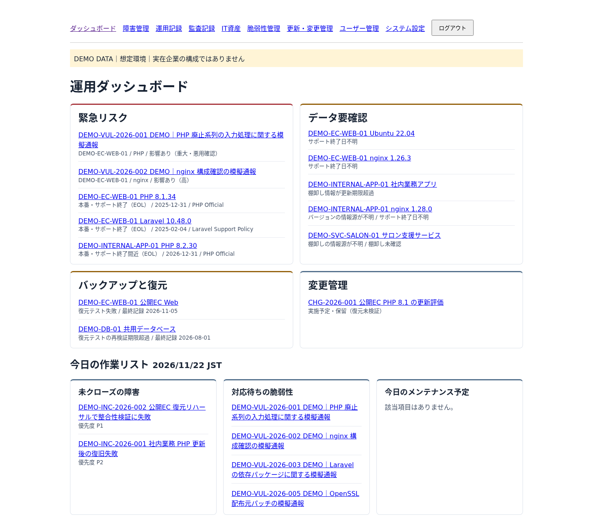
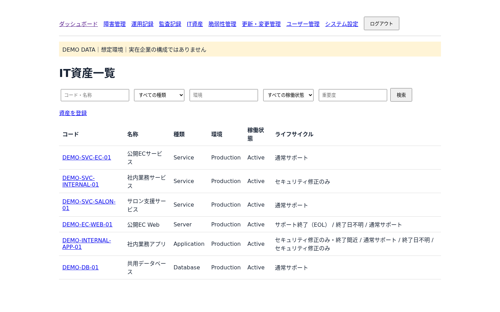
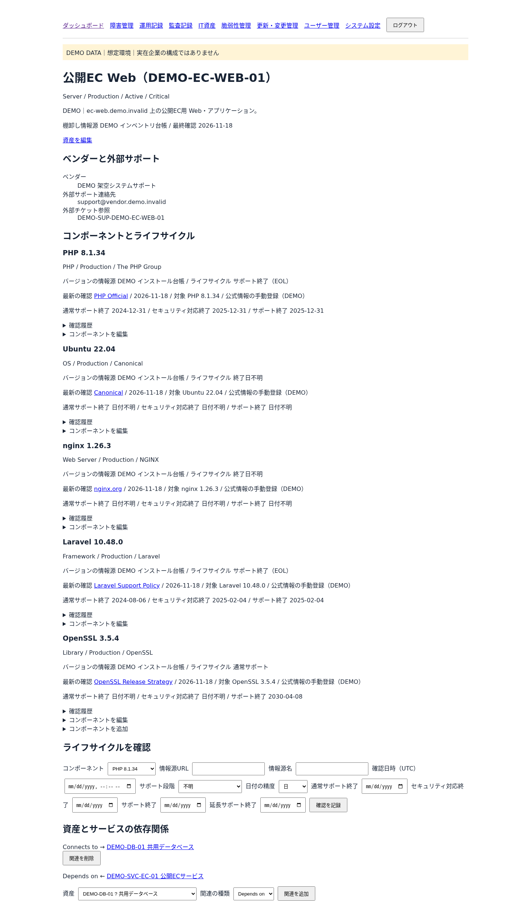
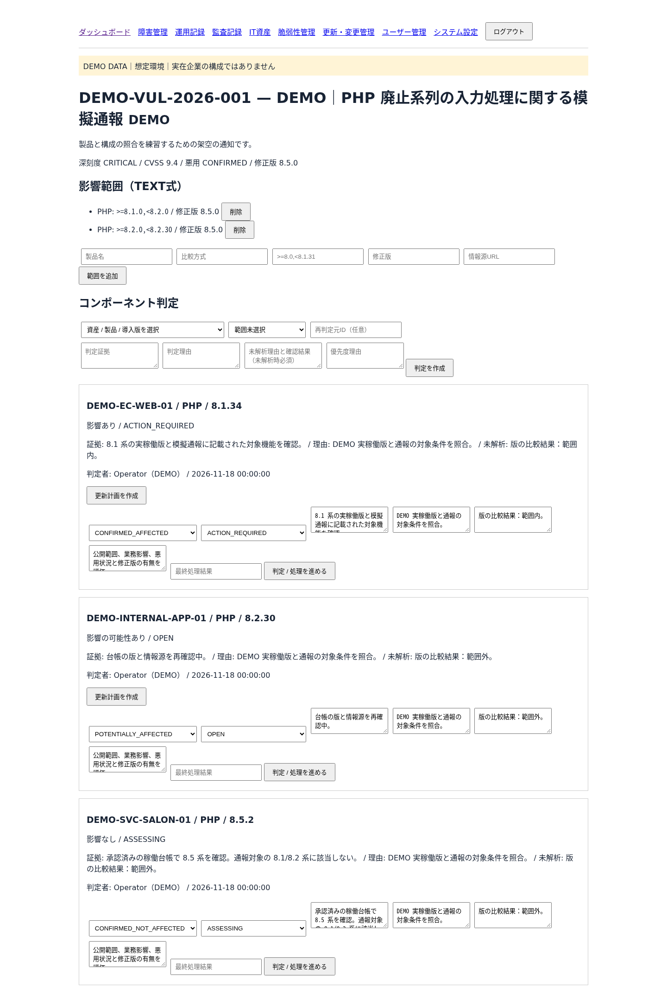
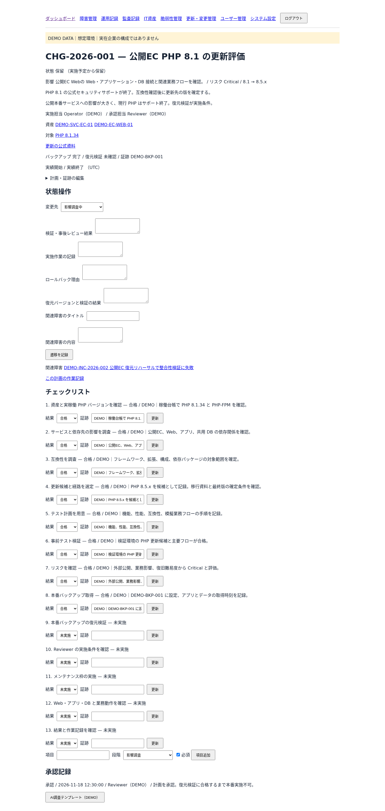
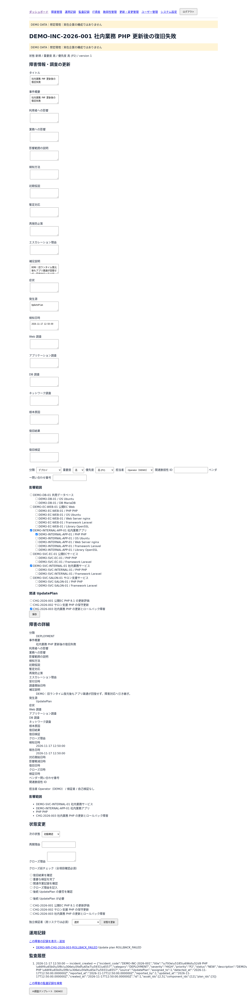
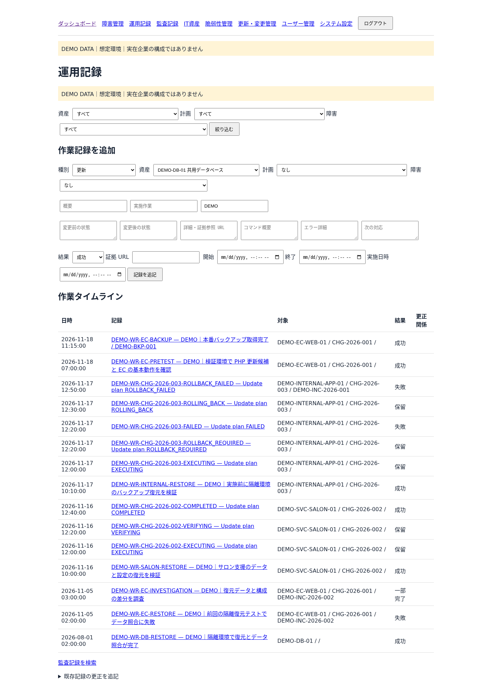
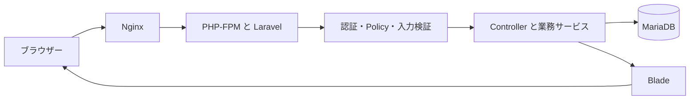

# SoloOps

## 01 免責事項

本リポジトリは、株式会社ムーランエムーランの公開求人票に記載された職務内容を参考に、応募者個人が学習および技術力の提示を目的として企画・開発するポートフォリオ作品です。

本プロジェクトは、株式会社ムーランエムーランから開発を依頼されたものではなく、同社による監修・承認を受けたものでもありません。また、同社の公式システムではありません。

同社の実際の社内システム、サーバー構成、ネットワーク構成、ソフトウェアのバージョン、運用手順、取引先・委託先との契約内容、およびセキュリティ状況について、当方は確認していません。

本リポジトリ内に登場する組織、サービス、サーバー、システム、資産、構成、ソフトウェアバージョン、脆弱性、障害、作業履歴、ユーザー等のデータは、別途出典を明記した一般公開情報を除き、すべて説明・検証用に作成した架空のデモデータです。これらを株式会社ムーランエムーランの実際の業務環境、システム構成、運用状況またはセキュリティ状況として解釈しないでください。

本ソフトウェアは、実環境への接続、脆弱性スキャン、パッチ適用、バックアップ、データ復元、ロールバック等を自動実行するものではありません。画面上の操作記録やデモシナリオは、実サーバー上で処理が実行されたことを意味しません。

実際の業務環境へ適用する場合は、対象環境に応じた専門的な調査、互換性検証、バックアップおよび復元テスト、関係者の承認、安全対策を別途実施する必要があります。

本プロジェクトの目的は、少人数の情報システム担当者を想定したIT資産管理、ソフトウェアライフサイクル管理、脆弱性評価、変更管理、障害対応および運用記録の仕組みを、個人の技術作品として設計・実装・検証することです。

## 02 Overview

SoloOps は、少人数の情報システム担当者向けの IT 運用・ライフサイクル・変更管理システムです。業務サービスと稼働コンポーネントを起点に、更新する理由、実施前の判断、作業結果を同じ記録からたどれます。初回の画面案内と確認順は、[面接官向けガイド](docs/INTERVIEW-GUIDE-ja.md)にまとめています。

## 03 Why SoloOps

PHP のサポート期限を確認した後も、どの業務に影響するか、誰が承認するか、どの証拠がそろえば更新してよいかを判断する作業が残ります。そこで実稼働版の確認から、影響調査、独立した承認、復元の検証までを一つの変更計画に結び付けました。引き継ぐ人は保留の理由や復元後の状態を、当時の根拠から確認できます。

## 04 Key Features

- ダッシュボードは、緊急リスク、要確認データ、バックアップと復元、変更管理、当日の作業を表示します。空の台帳では初期棚卸しの順序を示します。
- 資産は業務サービスや他の資産に関連付けられます。導入版、版の情報源、公式資料を確認した日時、ライフサイクル履歴はコンポーネントごとに管理します。
- 脆弱性の通報、影響範囲、環境ごとの判定を分けて保存します。バージョン比較の結果を候補として示し、担当者が証拠を添えて判定します。
- 変更計画は五段階のチェックリストに沿って進めます。復元未確認などの不足はサーバー側で止め、承認者、実績時刻、ロールバックの結果を記録します。
- 障害は Web、アプリケーション、DB、ネットワークの所見を別々に記録します。作業の訂正は元の記録にひも付けて追記し、監査記録で変更の経緯を確認できます。

## 05 Demo Scenarios

| シナリオ | 画面で確認すること |
| --- | --- |
| E2E-01 ライフサイクル | `DEMO-EC-WEB-01` の PHP 8.1 で、導入版と公式情報の確認日から更新計画へ進みます。`CHG-2026-001` は PHP 8.5.x を候補にしており、事前検証とバックアップの記録はありますが、復元検証待ちのため保留です。 |
| E2E-02 脆弱性対応 | 架空の通報から影響範囲と実稼働版を照合します。証拠付きの判定から計画を作成し、判定と計画を双方向にたどります。比較できない場合は調査を続けます。 |
| E2E-03 更新失敗とロールバック | 承認・実施失敗・復元検証を経てロールバック済みに遷移し、障害・作業・監査記録が残ることを HTTP テストで確認します。画面では `CHG-2026-003` で復元自体が失敗した分岐と、同時に登録された障害を確認できます。 |

## 06 Screenshots

### UI-01 運用ダッシュボード



### UI-02 IT 資産一覧



### UI-03 IT 資産詳細



### UI-04 脆弱性管理



### UI-05 更新・変更管理



### UI-06 障害管理



### UI-07 運用記録



## 07 Architecture



Controller が HTTP 入力を検証し、Policy が操作権限を確認します。状態遷移や版の比較はサービスに置き、Eloquent の関連と DB 制約で対象・証跡を結び付けます。監査記録の書き込みは `AuditLogger` に集約しています。21 業務テーブルの関連は[データモデル](docs/DATA-MODEL-ja.md)、遷移条件は[変更管理](docs/CHANGE-MANAGEMENT-ja.md)を参照してください。

## 08 Technology Stack

| 層 | 使用技術 |
| --- | --- |
| 実行環境 | PHP 8.5、Laravel 13、PHP-FPM |
| 画面 | Blade、CSS、少量の JavaScript |
| DB と Web | MariaDB 11、Nginx、Docker Compose |
| 検証 | PHPUnit、Laravel Test、PHPStan（Larastan）、Laravel Pint、Composer Audit、GitHub Actions |

Laravel の認証、Policy、バリデーション、マイグレーションを利用し、変更計画や障害対応のルールを PHP のモデルとサービスで確認できるようにしています。

## 09 Quick Start

Docker と Docker Compose を用意し、このリポジトリのルートで作業します。初回はコンテナイメージと依存関係の取得にネット接続が必要です。

1. `.env.example` を `.env` にコピーします。POSIX シェルでは `cp .env.example .env`、PowerShell では `Copy-Item .env.example .env` を実行します。
2. `.env` の `DB_PASSWORD` と `DB_ROOT_PASSWORD`、および次節にある四つの `DEMO_*_PASSWORD` に、ローカル専用の値をそれぞれ設定します。初期の `APP_URL` は `http://localhost:8080` です。
3. コンテナを起動し、アプリコンテナで依存関係の導入、キーの生成、マイグレーション、デモ投入を順に実行します。

   ```sh
   docker compose up -d --build
   docker compose exec -T app composer install --no-dev --no-interaction --prefer-dist
   docker compose exec -T app php artisan key:generate
   docker compose exec -T app php artisan migrate
   docker compose exec -T app php artisan db:seed
   ```

4. [ローカルのログイン画面](http://localhost:8080/login)を開き、次節のアカウントでログインします。Seeder は同じデータベースで繰り返し実行できます。デモの主要操作は、初期化後は外部 API への接続なしで確認できます。

## 10 Demo Accounts

| ユーザー名 | ロール | ローカルの `.env` 変数 |
| --- | --- | --- |
| `demo-admin` | Admin | `DEMO_ADMIN_PASSWORD` |
| `demo-operator` | Operator | `DEMO_OPERATOR_PASSWORD` |
| `demo-reviewer` | Reviewer | `DEMO_REVIEWER_PASSWORD` |
| `demo-viewer` | Viewer | `DEMO_VIEWER_PASSWORD` |

Reviewer は、高リスク変更に対する上長または権限を付与された承認者を想定したデモ上の役割であり、株式会社ムーランエムーランの実際の組織構成や承認体制を示すものではありません。

Seeder は設定したパスワードをハッシュ化して保存します。値が空のアカウントは作成を見送るため、四役のシナリオを再現するには四つの値を設定してから投入してください。

## 11 Test

テストはスキーマを初期化するため、デモとは別の空の MariaDB データベースを使います。以下は POSIX シェルでの例です。使用中のデモと同一の DB 名を指定しないでください。

```sh
docker compose exec -T db sh -c 'MYSQL_PWD="$MARIADB_ROOT_PASSWORD" mariadb -u root' <<'SQL'
CREATE DATABASE IF NOT EXISTS soloops_test CHARACTER SET utf8mb4 COLLATE utf8mb4_unicode_ci;
GRANT ALL PRIVILEGES ON soloops_test.* TO 'soloops'@'%';
SQL

docker compose exec -T app composer install --no-interaction --prefer-dist
docker compose exec -T -e DB_DATABASE=soloops_test app php artisan test
docker compose exec -T app vendor/bin/phpstan analyse --memory-limit=1G
docker compose exec -T app vendor/bin/pint --test
docker compose exec -T app composer audit
```

Laravel の HTTP テストで、三つの E2E、回復失敗時のトランザクション、四役の権限、ライフサイクル表示、シードの再実行などを検証します。GitHub Actions は PHP 8.5 と使い捨ての MariaDB で依存関係の導入、空 DB のマイグレーション、同じ品質チェックを実行します。

## 12 Security

認証とサーバー側の権限判定、CSRF 対策、Blade のエスケープ、DB のパラメータ束縛を使用します。高リスク変更は担当 Operator と独立した Reviewer が扱い、自己承認をアプリと DB の両方で禁止します。実在するサーバーの鍵・接続パスワード・API キーは業務記録に保存しません。追記専用テーブルの権限分離とローカル Compose の違いは[セキュリティ](docs/SECURITY-ja.md)を参照してください。

## 13 Limitations

ライフサイクル情報は公式資料の手動確認に基づきます。確認日を保存し、期限や情報が不明な場合は画面で区別します。変更・障害画面の AI 調査テンプレートは、人が読み合わせる静的なデモです。実環境の操作は行わず、フェーズ 1 の対象はローカルでの確認と運用記録です。外部データの自動取込、手順書やベンダーの台帳、テンプレート管理は将来の検討範囲です。

## 14 Project Structure

| ディレクトリ | 内容 |
| --- | --- |
| `app/Http/Controllers`、`routes` | HTTP の入口、入力検証、画面遷移 |
| `app/Models`、`app/Policies`、`app/Services` | 関連、権限、状態遷移、版比較、監査 |
| `database/migrations`、`database/seeders` | スキーマと架空のデモデータ |
| `resources/views` | Blade の日本語画面 |
| `app/Services/SettingsService.php`、`resources/views/settings/system` | Admin 専用のシステム設定（`/settings/system`） |
| `tests`、`.github/workflows` | 単体・HTTP テスト、CI |
| `docs` | [面接官向けガイド](docs/INTERVIEW-GUIDE-ja.md)、データモデル、変更管理、セキュリティ、画面キャプチャ |
| `examples/php-maintenance` | [PHP 保守の個人練習](docs/php-maintenance-case-study-ja.md)の再現コード |

## 15 Development Approach

人が機能範囲、役割、状態遷移、受入条件を定め、AI を実装・テスト・文書作成の支援に用いました。受入は人が差分とテスト結果を読み、ブラウザーでデモの動線と記録を照らし合わせて判断します。
